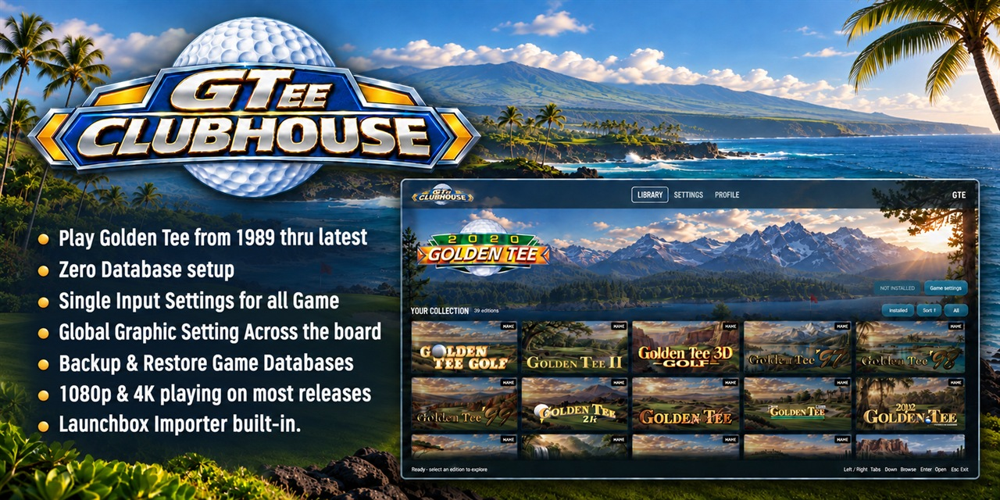
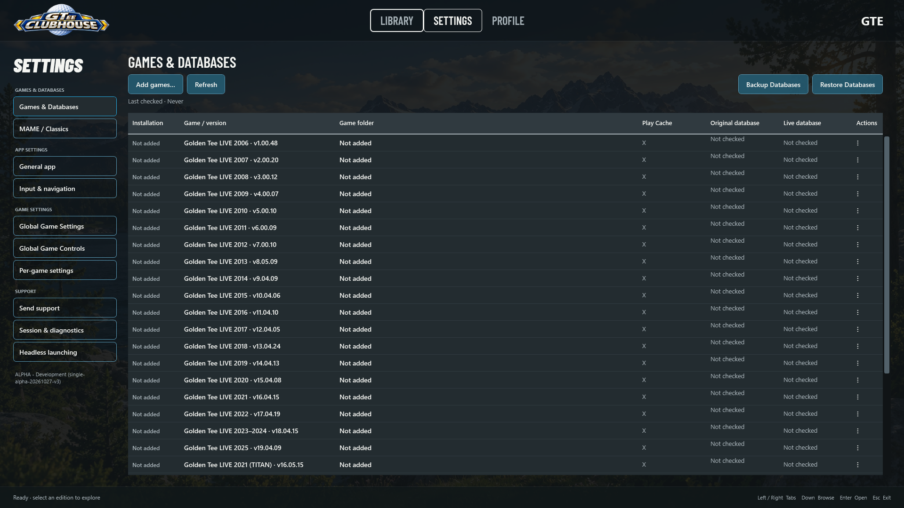

  

  

<h1 align="center">GTee Clubhouse</h1>

<strong>Your GT collection starting in 1989</strong>

  <a href="https://github.com/GTeeClubhouse/gtee-clubhouse-releases/releases">Releases</a> &nbsp; | &nbsp;
  <a href="#getting-started">Setup guide</a> &nbsp; | &nbsp;
  <a href="SUPPORT.md">Support</a> &nbsp; | &nbsp;
  <a href="https://github.com/GTeeClubhouse/gtee-clubhouse-releases/issues">Report an issue</a>

GTee Clubhouse brings decades of arcade golf into one visual library. Browse your games, add supported originals, configure your controls, and launch from a desktop or cabinet. From the original GT Golf through GT Fore!, GT LIVE Nighthawk and GT LIVE Titan hardware, and more, Clubhouse brings game setup and everyday management into the same interface.

## Disclaimer

GTee Clubhouse is a launcher for legally owned backup copies of your own software and games. No Incredible Technologies (IT) game software, game source code, or game data is distributed with this launcher, and no GT game source code is used to build it. We do not provide any games or game data. All backups are supplied by the user and must correspond to software and games they legally own; users are responsible for ensuring they have the right to use their backups.

## Download and release status

**0.1 Beta is a prerelease for Windows 10/11 x64.**

[Download the 0.1 Beta installer](https://github.com/GTeeClubhouse/gtee-clubhouse-releases/releases/download/v0.1-beta/GTee-Clubhouse-0.1-Beta-Setup.exe) · [Release notes, checksum and source archive](https://github.com/GTeeClubhouse/gtee-clubhouse-releases/releases/tag/v0.1-beta)

Includes a welcome screen and guided tour, Classic and Modern setup shortcuts, and controls for your mouse or trackball. Games, ROMs, CHDs and original databases are supplied separately. Read the [0.1 Beta requirements and installation notes](RELEASE-NOTES-BETA-1.0.md) before installing.

Start with the [setup guide below](#getting-started) to install Clubhouse and add your games.

## Main features

| Feature | What you can do |
| --- | --- |
| One visual library | Browse Classic and Modern editions with game logos, scenery, artwork, sorting, and installed-game filtering. |
| Welcome and guided tour | Start with Classic or Modern setup shortcuts, or follow a 35-step tour of the app. Reopen the tour from General app settings. |
| Zero manual database setup | Let Clubhouse prepare supported Modern games and create their private databases during game setup. No separate database-server installation or manual SQL configuration is needed for the normal setup flow. |
| Add multiple games | Select complete game folders individually, select several at once, or scan a parent folder for supported editions. |
| Classic games built in | Use the integrated MAME setup for the Classic library, with content checks, bezels, CRT effects, and other picture presets. Supply your own matching ROMs and CHDs. |
| Controls for your setup | Configure keyboard, Xbox/XInput, and DirectInput button mappings, plus supported mouse or USB trackball input. Navigate the launcher with a controller. |
| Global and per-game settings | Set shared defaults, then override supported options for individual editions. |
| Graphics quality controls | Choose Very Low through Very High presets and supported Advanced adjustments for eligible Modern editions. |
| Cabinet presentation | Use fullscreen display, customizable artwork and accent colors, and an optional marquee on a second display. |
| Auto-export to LaunchBox | Export all or installed games with supplied metadata, artwork assets, and ready-to-use headless launch commands. Clubhouse creates the entries and organizes them in LaunchBox for use with LaunchBox and Big Box. |
| Backup and recovery | Back up and restore Modern databases individually or in batches, with recovery checks built into the workflow. |
| Built-in diagnostics | Review setup readiness, check content, stop a background session, and prepare a support report from the app. |

## Able to play your full Library.

Clubhouse brings the full span of GT history into one place. Its catalog covers these families:

| Family | Editions |
| --- | --- |
| Early Classics | GT Golf (1989 trackball edition), GT Golf II, GT 3D Golf, GT '97, GT '98, GT '99, GT 2K, and GT Classic |
| Fore! | GT Fore!, Fore! 2002, Fore! 2003, Fore! 2004 Extra, Fore! 2005 Extra, and Fore! Complete |
| GT LIVE Nighthawk | GT LIVE Nighthawk 2006–2025 |
| GT LIVE Titan | GT LIVE Titan 2021, 2022, 2023–2024, 2025, and 2026 |
| Additional games | More supported games available through 2027. See the release notes for details. |

Exact game versions matter. A catalog entry does not mean every revision or hardware configuration is qualified; check the applicable release notes for edition-specific requirements and known issues.

## Zero manual database setup

Adding a supported Modern game handles the routine preparation for you. Clubhouse checks the selected original files, prepares its Play Cache, and imports the required original database backup into a private database when one is missing.

You do not need to install PostgreSQL separately, create database users, configure a system service, or run SQL commands. The required database runtime is managed by Clubhouse, with separate state for each edition.

**Zero manual setup does not mean the games run without databases.** Provide the complete supported original game folder, including its required backup and supporting files. A lone `game.bin` is not enough. Clubhouse keeps its managed runtime state separate from the original game content.

View the Games &amp; Databases interface

*Earlier development interface shown for orientation.*

## Getting started

### 1. Install Clubhouse

Download and run **GTee-Clubhouse-0.1-Beta-Setup.exe**. Choose an empty, writable folder for Clubhouse and follow the installer prompts.

Allow at least 8 GB free for installation, plus room for game files, Play Cache, databases and backups. Setup also uses temporary space on the Windows drive. On exFAT, setup warns that temporary private sessions use Local AppData on the Windows drive; settings and saved databases remain in the chosen installation folder.

Open **GTee Clubhouse.exe** after setup. Fresh installations start fullscreen and show the welcome screen; choose **Guided Tour**, **Classic**, **Modern** or **Close**. Press **F11** to switch between fullscreen and a window. The runtime is bundled; no separate .NET or PostgreSQL installation is required.

You only need the Setup.exe file to install Clubhouse. The corresponding-sources ZIP contains third-party source and license material; it is not needed to install or play.

### 2. Add Modern games

1. Open **Settings > Games & Databases**.
2. Select **Add games** and choose your complete supported original game folder. Use Ctrl/Shift to select multiple folders, or scan their parent folder.
3. Let Clubhouse finish content verification, Play Cache preparation, and database setup. The first setup can take time, depending on the game and drive.
4. Review the reported status. Resolve missing or incompatible files before continuing.
5. Return to **Library**, select the edition, and choose **Play** when it is ready.

### 3. Add Classic games

Use your legally owned backups from the **MAME 0.289 ROM set**, with the matching CHDs where required. Clubhouse bundles MAME 0.289; ROM sets from other versions may not match its content checks. Keep ROM ZIPs zipped and retain the required parent/BIOS files.

1. Open **Settings > MAME / Classics** and choose your existing ROM collection using the ROMs folder field, or use the default directory shown there.
2. Follow the default ROM folder's **ADD TO ROMS FOLDER.txt** instructions. Keep required ROM ZIPs and CHDs in their expected named game folders.
3. Keep ROM ZIPs zipped, and include any required parent ROM or BIOS files.
4. Select **Refresh** and check the ROM/CHD status. A green **Not required** entry is normal when that component is unnecessary.
5. Select the game in **Library** and play.

The Classic runtime and its routine configuration are integrated into Clubhouse; you do not need to set up a separate MAME frontend.

### 4. Set your controls and display

Use **Input & navigation** for launcher navigation, **Global Game Controls** for shared button mappings, and **Global Game Settings** for display and game defaults. Choose your trackball device or the appropriate mouse input mode, then adjust sensitivity to suit your setup.

Use **Per-game settings** for supported edition-specific overrides. Classic picture filters, bezels, sensitivity, and volume are available under **MAME / Classics**. Modern graphics controls depend on the selected edition.

### 5. Connect your cabinet frontend

Clubhouse can run on its own or launch games through its headless entry point. Use **Headless launching** to obtain the command for your chosen game and saved settings.

**Auto-export games to LaunchBox with artwork and metadata.** Close LaunchBox and Big Box, choose your LaunchBox folder in Clubhouse, and select **Export** for all games or installed games. Clubhouse automatically creates the game entries, supplies their metadata and headless launch commands, copies available artwork assets, and adds the games to the Arcade platform and GT playlist.

Artwork includes clear logos, fanart backgrounds, marquees, posters, and available front-box and 3D-box images. The export handles the entries and assets together, so you can launch through LaunchBox or Big Box using your saved Clubhouse settings without building each entry by hand.

Review the overwrite/skip choice when matching entries already exist. Enable the optional second-screen marquee in the app's general settings if your cabinet has a marquee display.

## Backups and updates

If Clubhouse needs repair, close it and your games, then run the installer again and select the same installation folder. Back up important progress before maintenance.

Uninstall through **Windows Settings > Apps > Installed apps**. Choose whether to keep your settings and databases or delete Clubhouse data and recovery backups. Original game folders outside the installation are preserved.

Use **Backup Databases** before upgrades or major changes. **Restore Databases** lets you review matching backups before restoring them. Keep a separate copy of important backups outside the installation folder.

Do not use **Remove game** as an update or repair shortcut: it can remove Clubhouse-owned progress, internal backups, and cache. Use the release's documented update or recovery process instead.

## Troubleshooting and support

- **A Modern game will not add:** Confirm that the full original folder matches a supported version and includes the required database backup and supporting content.
- **A Classic game is unavailable:** Check its ROM, parent/BIOS, and CHD requirements in **MAME / Classics**, then select **Refresh**.
- **Play is blocked by a previous session:** Open **Session & diagnostics**, use **Stop background session**, and let cleanup finish before trying again.
- **Controls or graphics need adjustment:** Start with the documented defaults, check the selected input device and per-game overrides, and include your edition and settings when reporting a problem.
- **You need help:** Read [SUPPORT.md](SUPPORT.md), check [existing issues](https://github.com/GTeeClubhouse/gtee-clubhouse-releases/issues), and include your Clubhouse version, Windows version, game edition, and steps to reproduce the problem.

Support reports can be prepared and sent from the app's Support page. Successful uploads show a confirmation; a selectable local ZIP path is available for manual sharing if upload fails. Keep private databases, game files, account information and raw support archives out of public issues.

## Buy me Coffee

[Buy me Coffee](https://ko-fi.com/N4N32AC2LY)

This repository contains public release documentation and support information. Game content, ROMs, CHDs, original databases, saved progress, and personal configuration are supplied separately and are not distributed here. Third-party notices and required corresponding source accompany the applicable release; see [THIRD-PARTY-NOTICES.md](THIRD-PARTY-NOTICES.md).
